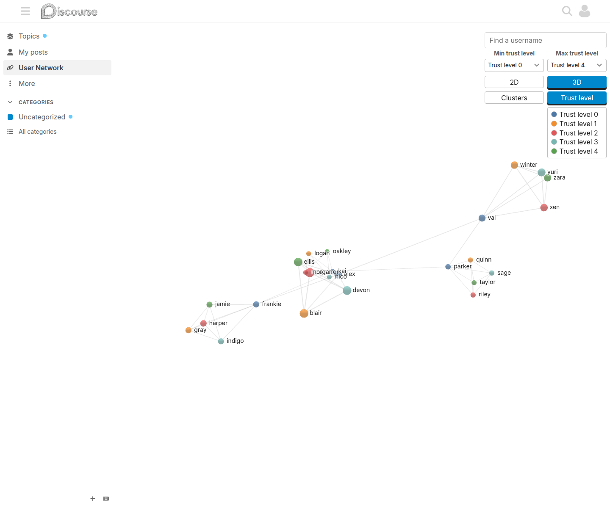
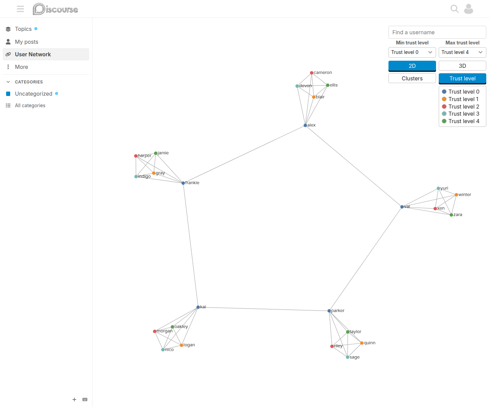
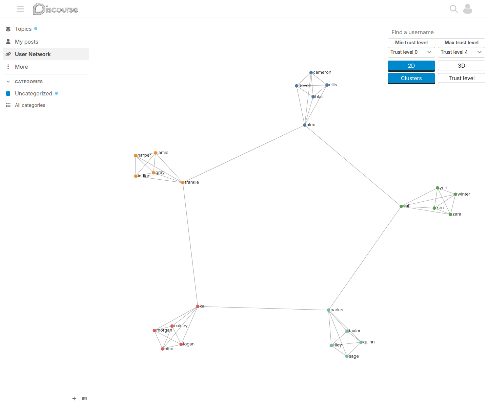
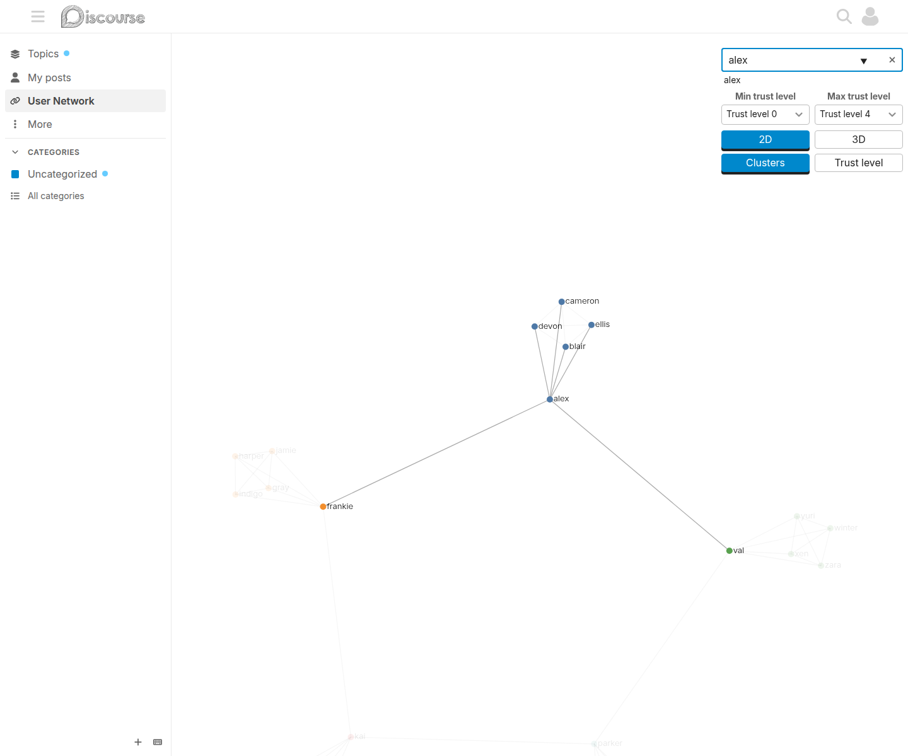

# Discourse User Network Visualisation Plugin

Explore your community's connections through an interactive network of likes and
replies, in 2D or 3D.



## Features

- Switch between a 2D force-directed graph and a rotatable 3D network with
  camera-facing username labels. 3D is the default.
- Use the available browser width and height below the header, including when
  the Discourse sidebar is open.
- Hover over a user to emphasise their connections; click a node to open their
  profile summary. Drag nodes and zoom to explore.
- Find a username as you type, without additional server requests.
- Filter the visible users by minimum and maximum trust level.
- Switch between trust-level colours (with a legend) and relationship clusters
  without restarting the layout.
- Inspect the cached graph and review concentrated new-user interactions with
  two optional Data Explorer queries.

Nodes represent users; thicker links indicate higher interaction scores. Scores
combine likes and weighted direct replies, not every kind of forum activity.
Spatial proximity is a force-layout result, not a measure of identity or agreement.

## Screenshots

These are real browser captures of a Discourse test instance containing fictional
users and generated replies, not production community data.

### 2D and trust levels



### Relationship clusters



### Username search



See [screenshot capture instructions](assets/screenshots/README.md) to reproduce
these views. The [intro topic](intro-topic.md) is the forum-ready introduction.

## Installation and access

Follow the [Discourse plugin installation guide](https://meta.discourse.org/t/install-a-plugin/19157)
using this repository:

```yaml
- git clone https://github.com/merefield/discourse-user-network-vis.git
```

After rebuilding Discourse, enable `user_network_vis_enabled`. Signed-in members
can open **User Network** in the desktop sidebar or visit `/usernetworkvis`.
The sidebar link is optional; it is not added on mobile. 3D requires WebGL support;
the 2D view is also available.

Wait for the first hourly calculation, or trigger it as described below if the
graph is empty.

## Username search

The graph's search uses the loaded nodes only, with no server requests. Each
keypress centres and highlights the best match (exact username, then prefix,
then substring, case-insensitively). The input offers matching usernames.
Clearing it removes the selection. Hover temporarily highlights another user;
leaving restores the search selection. Colours and dimensions preserve the
selection. Users excluded by the graph's settings cannot be searched.

Minimum and maximum trust-level dropdowns isolate an inclusive slice of the
loaded graph. Both views hide excluded nodes, labels and connecting edges
without rebuilding the simulation; search follows the visible slice. Crossing
the limits adjusts the other dropdown to keep the range valid. These controls
cannot restore users excluded from the snapshot by server settings.

## Colours and clusters

Both views use the exact five configured trust-level colours. **Trust level**
shows a legend; **Clusters** groups users by weighted connections using a
Louvain-style community-detection method and reuses the same palette.

Clustering is not limited to five communities. The five largest communities get
the five colours; smaller communities reuse a colour based on connections to
those larger groups, falling back to the first colour. A shared colour therefore
does not necessarily mean a single community, and cluster colours are not trust
levels. Changing colours does not move the nodes.

## Settings

Find these in the admin site settings by searching for `user_network_vis`.

### Display

| Setting                                 | Default   | Purpose                       |
| --------------------------------------- | --------- | ----------------------------- |
| `user_network_vis_enabled`              | `true`    | Enable the plugin.            |
| `user_network_vis_add_menu_item`        | `true`    | Add the desktop sidebar link. |
| `user_network_vis_default_view`         | `3d`      | Initial view: `2d` or `3d`.   |
| `user_network_vis_node_radius`          | `6`       | Node sizing.                  |
| `user_network_vis_node_charge_strength` | `700`     | Repulsion between nodes.      |
| `user_network_vis_trust_level_0_color`  | `#4e79a7` | Trust level 0 colour.         |
| `user_network_vis_trust_level_1_color`  | `#f28e2c` | Trust level 1 colour.         |
| `user_network_vis_trust_level_2_color`  | `#e15759` | Trust level 2 colour.         |
| `user_network_vis_trust_level_3_color`  | `#76b7b2` | Trust level 3 colour.         |
| `user_network_vis_trust_level_4_color`  | `#59a14f` | Trust level 4 colour.         |

There is no fixed canvas-height setting: the graph fills the available space
below the header.

### Snapshot calculation

Changes to these settings take effect on the next calculation, not immediately
in an already loaded graph.

| Setting                                    | Default | Purpose                                         |
| ------------------------------------------ | ------- | ----------------------------------------------- |
| `user_network_vis_minimum_trust_level`     | `0`     | Exclude lower-trust users from the snapshot.    |
| `user_network_vis_maximum_last_seen_years` | `10`    | Include only users seen within this many years. |
| `user_network_vis_reply_multiplier`        | `2`     | Weight direct replies relative to likes.        |
| `user_network_vis_link_score_threshold`    | `0`     | Minimum score for an edge to be included.       |

## Refreshing the graph

`Jobs::UserNetworkStatsCalc` runs hourly and stores a shared snapshot. An
administrator can trigger it from `/sidekiq/scheduler`, or enqueue it from the
Rails console:

```ruby
Jobs.enqueue(:user_network_stats_calc)
```

Reload the graph after the job finishes. Large sites can have expensive
calculations and crowded graphs; monitor job duration and adjust snapshot
filters as appropriate. Browser filters do not reduce the calculation workload.

## Data and privacy

Signed-in members can fetch the same snapshot at `/usernetworkvis.json`. It
contains usernames, trust levels and weighted edges, not post bodies. This is
not an administrator-only graph or a personalised permission-filtered snapshot.

Private messages are excluded. However, the current graph calculation's reply
query does not filter restricted categories or invisible topics as the likes
query does. Review this limitation before enabling the plugin on a community
with sensitive areas. The Data Explorer review query below has stricter
visibility exclusions. Setting identical colours does not hide trust levels
from the JSON data.

## Data Explorer

When Data Explorer is installed, the once-off
`CreateUserNetworkExplorerQueries` job creates two system-owned queries without
group sharing:

- **User network: graph snapshot** reads the same cached edges and weighted scores
  as the visualisation. The optional username parameter accepts SQL patterns,
  such as `alice` or `ali%`; `%` returns all edges. It reflects the most recent
  graph calculation, not live interactions. Stored source/target directions mix
  like recipients and reply authors and must not be interpreted as a consistent
  direction of endorsement.
- **User network: concentrated new-user interactions** reads recent public likes
  and direct replies. Defaults select accounts created within 90 days with at
  least 10 interactions in the past 30 days, at most three counterparts, and at
  least 80% of interactions with one counterpart. Parameters are adjustable.
  It reports incoming likes/replies, outgoing interactions, reciprocal
  counterparts, and the strongest counterpart's account age and trust level.
  It uses regular posts only, excluding whispers, private messages, restricted categories, hidden/deleted posts,
  self-interactions and staff candidates. It does not apply the graph's minimum
  trust level or weighted edge threshold, which could hide new users.

The second query is a review aid. Concentrated interactions can be legitimate;
it does not establish shared identity, calculate an abuse probability, or take
moderation actions. Reciprocity means interactions in both directions; it need
not be reciprocal likes. Counts cover the selected time window, not lifetime
relationships or complete community isolation. Use the graph and post history
to investigate context. Data Explorer's existing permissions control access.

The installer preserves edits, renamed queries and intentional deletions on
reruns. If Data Explorer is installed later, run this in the Rails console:

```ruby
Jobs.enqueue(:create_user_network_explorer_queries, force: true)
```

This installs missing query definitions without rebuilding the graph. The SQL
sources are in `queries/`; changing those files does not overwrite installed
queries.

## Ruby loading

The engine is loaded during plugin setup; Rails loads routes and Zeitwerk manages
the namespaced controller and job files. The engine's `to_prepare` hook eagerly
loads `app/jobs/scheduled` so the hourly calculation is registered on boot and
after development reloads. Keep Ruby filenames aligned with their constants
instead of adding manual requires in `after_initialize`.

`UserNetworkVis::PLUGIN_NAME` remains `user_network_vis`, preserving the existing
PluginStore snapshot and installed-query records. Job class names and the
`/usernetworkvis` endpoint are unchanged.

From a Discourse checkout with the plugin installed:

```sh
LOAD_PLUGINS=1 RAILS_ENV=test bin/rails zeitwerk:check
LOAD_PLUGINS=1 bin/rspec plugins/discourse-user-network-vis/spec
```

The engine spec additionally checks the plugin's `lib` directory, which Rails'
standard eager-loading check may omit.

## Discuss the plugin

Questions, feedback and support:
[Community network visualisation](https://meta.discourse.org/t/community-network-visualisation/184189).

## Support this work

[Sponsor merefield on GitHub](https://github.com/sponsors/merefield) to support
maintenance and development.

## Credits and related projects

The visualisations use [D3](https://d3js.org/) and
[3D Force Graph](https://github.com/vasturiano/3d-force-graph), built on
[Three.js](https://threejs.org/). Vendored libraries and their licence files live
in `public/`.

You may also like [Word cloud](https://meta.discourse.org/t/word-cloud-plugin/210169)
and [Discourse tag cloud](https://meta.discourse.org/t/discourse-tag-cloud/218014).
